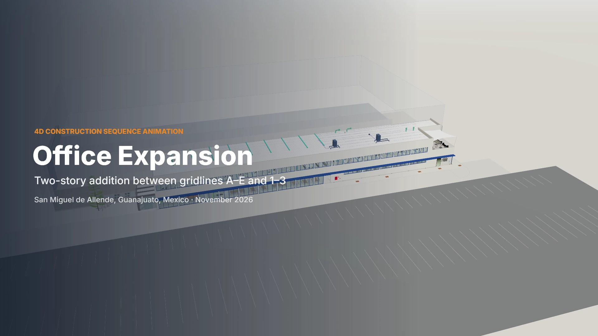

# ANIMACIÓN 4D

### [▶ Ver el video · Watch the video](https://dominic-soto.github.io/ANIMACION-4D/)

Animación de 2:20 del proceso constructivo de una expansión de oficinas de dos niveles: vista general, despiece isométrico, proceso constructivo 4D en ocho etapas y recorrido final. Los textos del video están en inglés.

*A 2:20 animation of how a two-story office expansion is built: an overview, an exploded isometric view, the 4D construction sequence in eight stages, and a final walkthrough.*

| | |
|---|---|
| Ver en línea · Watch online | <https://dominic-soto.github.io/ANIMACION-4D/> (4K, con opción HD) |
| Descargar · Download | [4K · MP4 · 636 MB](https://github.com/Dominic-Soto/ANIMACION-4D/releases/download/v1.0/Office-Expansion-4D-Video-4K.mp4) |
| Duración · Duration | 2:20 |
| Resolución · Resolution | 3840 × 2160 (4K UHD), 30 fps |
